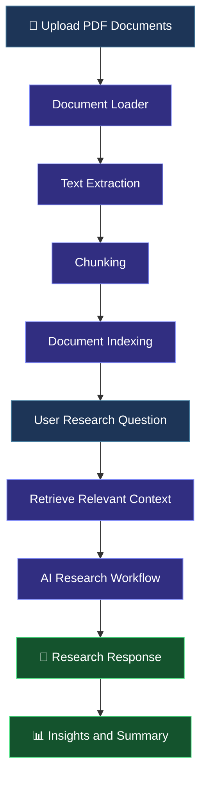

# 🧠 DocuMind AI
### Your Intelligent AI-Powered Document Research Assistant

<p align="center">
  
  
  
  
</p>

<p align="center">
  <b>Upload documents. Ask questions. Discover insights.</b>
</p>

<p align="center">
  DocuMind AI is an AI-powered document research assistant designed to help users explore PDF documents, retrieve relevant information, summarize content, and answer questions through an intuitive interface.
</p>

---

## 📌 Table of Contents

- [🎯 Overview](#-overview)
- [❗ Problem Statement](#-problem-statement)
- [💡 Solution](#-solution)
- [✨ Features](#-features)
- [🛠️ Tech Stack](#️-tech-stack)
- [🏗️ Project Architecture](#️-project-architecture)
- [📂 Project Structure](#-project-structure)
- [⚙️ Getting Started](#️-getting-started)
- [🚀 Running the Application](#-running-the-application)
- [💬 Example Questions](#-example-questions)
- [🔐 Environment Configuration](#-environment-configuration)
- [🗺️ Future Enhancements](#️-future-enhancements)
- [🤝 Contributing](#-contributing)
- [📄 License](#-license)
- [👨‍💻 Author](#-author)

---

## 🎯 Overview

**DocuMind AI** aims to simplify document research by bringing document processing, intelligent retrieval, and AI-assisted question answering into one application.

Instead of manually searching through lengthy PDFs, users can upload documents and interact with their content using natural-language questions.

The project combines Python-based document processing with an interactive Streamlit interface and an AI research workflow.

## ❗ Problem Statement

Reading lengthy documents and manually locating important information can be time-consuming, especially when users need to summarize reports, compare findings, or find specific answers.

## 💡 Solution

DocuMind AI aims to streamline this process by enabling users to upload PDF documents, retrieve relevant content, ask questions, and generate research-oriented responses through an intuitive AI-powered interface.

---

## ✨ Features

| Feature | Description |
|---|---|
| 📄 PDF Processing | Upload and process PDF documents. |
| 🔎 Intelligent Retrieval | Retrieve relevant document content for research questions. |
| 🤖 AI-Powered Q&A | Ask questions about indexed document content. |
| 📝 Document Summarization | Generate concise summaries of document information. |
| 💡 Key Insights | Explore important findings and takeaways. |
| ⚖️ Document Comparison | Support comparison-oriented research tasks. |
| 💬 Interactive Interface | Interact with the research assistant through Streamlit. |
| 📤 Research Workflow | Organize document ingestion, indexing, and question answering. |

> **Note:** The availability and quality of each feature depend on the current implementation and the configured AI model and retrieval backend.

---

## 🛠️ Tech Stack

<p>
  
  
  
  
  
  
  
</p>

### Core technologies

- **Python** — application logic and backend development.
- **Streamlit** — interactive web application interface.
- **Document Processing** — loading and preparing PDF content.
- **Retrieval-Augmented Generation (RAG)** — connecting retrieved document context with AI-generated responses.
- **Large Language Models (LLMs)** — generating natural-language answers when a model is configured.
- **Docker** — containerization support, if configured in the project.

---

## 🏗️ Project Architecture

The application follows a modular workflow that separates document ingestion, indexing, and research.



### Workflow explained

1. **Upload:** The user uploads one or more supported PDF documents.
2. **Load:** The document loader extracts content from the uploaded files.
3. **Chunk:** Extracted content is divided into smaller sections.
4. **Index:** Document chunks are prepared for retrieval.
5. **Retrieve:** Relevant content is selected for the user's question.
6. **Research:** The research workflow processes the question and retrieved context.
7. **Respond:** The application presents a response intended to help the user understand the documents.

---

## 📂 Project Structure

The project is organized into separate modules for the application interface, ingestion pipeline, and AI research workflow.

```text
documind-ai/
│
├── app.py
├── pyproject.toml
├── requirements.txt
├── Dockerfile
├── docker-compose.yml
├── .dockerignore
├── .gitignore
├── .env.example
├── README.md
├── LICENSE
│
└── src/
    └── documind/
        ├── agent/
        │   └── graph.py
        │
        └── ingestion/
            ├── loaders.py
            ├── chunking.py
            └── indexing.py
```

**Key files**

| File | Responsibility |
|---|---|
| `app.py` | Streamlit application interface. |
| `graph.py` | Research workflow and response generation. |
| `loaders.py` | PDF loading and text extraction. |
| `chunking.py` | Splitting document content into chunks. |
| `indexing.py` | Preparing document chunks for retrieval. |
| `requirements.txt` | Python dependencies. |
| `pyproject.toml` | Project metadata and Python tooling configuration. |
| `Dockerfile` | Instructions for building the application container. |
| `docker-compose.yml` | Container orchestration configuration. |
| `.env.example` | Example environment variable configuration. |

---

## ⚙️ Getting Started

Follow these steps to run DocuMind AI locally.

### Prerequisites

Install the following before starting:

- Python 3.10 or a compatible version supported by your dependencies.
- Git.
- A code editor such as Visual Studio Code.
- Any API credentials required by your configured AI provider.

### 1. Clone the repository

Replace the placeholder with your actual GitHub repository URL.

```bash
git clone https://github.com/YOUR_USERNAME/documind-ai.git
cd documind-ai
```

### 2. Create a virtual environment

**Windows — Command Prompt**

```bash
python -m venv .venv
.venv\Scripts\activate
```

**Windows — PowerShell**

```powershell
python -m venv .venv
.\.venv\Scripts\Activate.ps1
```

**macOS / Linux**

```bash
python3 -m venv .venv
source .venv/bin/activate
```

### 3. Install dependencies

```bash
python -m pip install --upgrade pip
pip install -r requirements.txt
```

### 4. Configure environment variables

If the project requires API keys or other environment variables, create your local `.env` file from the example:

**Windows — Command Prompt**

```cmd
copy .env.example .env
```

**PowerShell**

```powershell
Copy-Item .env.example .env
```

Update `.env` with the variables required by your configured provider.

> 🔐 Never commit your actual `.env` file, API keys, passwords, or other secrets to GitHub.

### 5. Run the application

```bash
streamlit run app.py
```

Open the local URL shown in your terminal, usually:

```text
http://localhost:8501
```

---

## 🚀 Running the Application

Once the application starts:

1. Open DocuMind AI in your browser.
2. Upload the PDF document you want to analyze.
3. Follow the application's indexing workflow.
4. Select the appropriate research task.
5. Enter a question about your document.
6. Review the generated response and compare it with the source document.

**Tip:** Start with a short, text-based PDF to validate document extraction and retrieval before testing larger reports.

---

## 💬 Example Questions

Try asking questions like these after uploading a suitable document:

- What is the main objective of this report?
- Summarize the document in simple language.
- What are the most important findings?
- Identify the major challenges and limitations.
- What recommendations does the author make?
- Extract the key statistics and explain their significance.
- Compare the findings of two uploaded reports.
- Which conclusions are supported by the document, and which require further evidence?

These are example prompts; results depend on the uploaded
